# attack12 — инъекция просадки питания в проверку PIN на RP2350

## Суть

Устройство второго этапа на RP2350 запускает `usb_token` через `enc_bootloader` и держит накопитель за четырёхзначным PIN. Шифрование и аутентификация развязаны: ключ AES-256 лежит в OTP и от PIN не зависит, а проверка PIN — независимый замок в коде приложения. Этот отчёт бьёт по замку: короткая просадка питания в момент сравнения хеша должна перевести исполнение в ветку успеха, минуя ввод верного PIN

Вектор продолжает V9 и V27 первого этапа, которые остались планом, и проверяет утверждение `REPORT_RP2350.md` о стойкости к инъекции сбоя на живом чипе, а не по публикациям

## Что установлено

Проверка PIN целиком, на четвёртом нажатии кнопки энкодера

```asm
20000be6  bl   0x200008d8        ; SHA-256(ASCII(PIN) || salt4), 32 байта на стеке
20000bf0  movs r2, #32
20000bf2  ldr  r1, [sp, #44]     ; хеш из OTP page 48
20000bf4  add  r0, sp, #52       ; вычисленный хеш
20000bf6  bl   0x20007ae8        ; memcmp по 32 байтам
20000bfa  mov  r4, r0
20000bfc  cbz  r0, 0x20000c02    ; совпало — успех
20000bfe  movs r4, #0
20000c00  b.n  0x20000c34        ; ветка в путь отказа
20000c02  ...                    ; успех
20000c20  movs r2, #1            ; флаг разблокировки
```

Целевая инструкция — `b.n` на `0x20000c00`. Её пропуск переводит исполнение на `0x20000c02`. Второй путь к тому же результату — обнулить возврат `memcmp`, тогда сработает `cbz r0` на `0x20000bfc`. Оба пути дают одно наблюдаемое следствие, и кампания их не различает

Адреса выводит [`src/verify_glitch_target.py`](src/verify_glitch_target.py) из байтов расшифрованного образа, а не переносит их вручную: ошибка в адресе увела бы весь свип туда, где попадания невозможны, и на стенде это никак не проявилось бы

Попутные факты о приложении:

- Энкодер сидит на GPIO 27 (B), 28 (кнопка), 29 (A) — та же распиновка, что у платы первого этапа, поэтому эмулятор из [`attack4`](../attack4/pico-encoder-emulator/) подходит без правок
- Приложение дёргает выводы не записями в SIO, а инструкциями `mcrr p0, …` — это GPIO-сопроцессор RP2350 (GPIOC), даташит раздел 3.6.1. Дизассемблеры показывают его как сопроцессорные инструкции, и это не мусор и не обфускация
- Индикация приложения занимает GPIO 0–13, таблицы выводов лежат на `0x20008d2c` и `0x20008d28`

## Стенд



Атакующий и цель стоят на одной плате, между ними ключ crowbar `AO3400`. Он сажает рельс `5 В` цели, то есть вход её регулятора, через перемычку вместо `R3`. Затвором управляет драйвер `UCC27511`, потому что вывод RP2040 даёт 12 мА, а затвору нужно около 0,5 А: без драйвера фронт просадки получается 150 нс вместо нужных единиц наносекунд

Роли, подключения, триггерная цепочка, сетка кампании и границы доказательства — в [`WIRING.md`](WIRING.md). Источник схемы — [`src/circuit.mmd`](src/circuit.mmd)

## Статус

Работа не завершена: кампания не проводилась, попаданий и промахов нет. Установлены цель глитча, распиновка энкодера, схема crowbar и цепь затвора. Остаётся собрать драйвер затвора, провести калибровку и прогнать сетку

Отдельно к `REPORT_RP2350.md`: разбор первоисточников показал, что E16, E20 и E21 закрыты в A3, а не в A4, что Raspberry Pi говорит `mitigate`, а не "закрыто", и что A4 ломали лазером. Это отдельная правка отчёта второго этапа

## Границы доказательства

- Инъекция идёт по 3V3 с гребёнки, а не по `DVDD`: на RP2350 Zero рельс ядра наружу не выведен, и часть импульса теряется на регуляторе и ёмкостях
- Аналогового измерения просадки нет: АЦП RP2040 даёт 2 мкс на отсчёт, а импульс лежит в десятках наносекунд
- Положительный контроль — лестница сброса: он подтверждает доставку импульса, но не умение пропускать инструкцию
- Детекторы глитчей на устройстве разряжены, поэтому отсутствие сброса не служит доказательством стойкости
- Отрицательный результат без сработавшего положительного контроля недействителен и помечается прямым текстом

## Источники

- Muench, Cullen, Courdesses, Roth, Zonenberg. Security through Transparency: Tales from the RP2350 Hacking Challenge. USENIX WOOT 2025 — https://www.usenix.org/system/files/woot25-muench.pdf
- Raspberry Pi. PCN 28, RP235x A4 stepping — https://pip.raspberrypi.com/categories/1263-pcn/documents/RP-008771-CC/RP235x-A4-stepping-PCN.pdf
- RP2350 Datasheet, приложения C и D — https://datasheets.raspberrypi.com/rp2350/rp2350-datasheet.pdf
- Исходники boot ROM с тегами A2, A3 и A4 — https://github.com/raspberrypi/pico-bootrom-rp2350
- Ledger Donjon. Photon-Emission-Guided Laser Fault Injection Enables RP2350 Secure Debug — https://donjon.ledger.com/blog/rp2350-secure-debug-laser-fault-injection/
- AO3400, UCC27511 и Si2302CDS — даташиты производителей

## Повторение проверки цели

```sh
python3 attack12/src/verify_glitch_target.py
```

Скрипт проверяет кодировки трёх инструкций и адрес флага разблокировки, возвращает 1 на первом расхождении. Оба вида порчи — испорченная ветка и подменённый пин энкодера — проверены на подложенных копиях образа
