# attack12 — стенд VFI на RP2350

Стенд — одна плата: слева атакующий контроллер, справа цель, между ними ключ crowbar. Земли сведены проводами, сигнальные линии тоже идут проводами: на плате медью они не разведены

## Роли

| Роль | Что | Где |
| --- | --- | --- |
| target | RP2350 Zero, вендорский образ `usb_token`, флеш не меняется | `U2`, справа |
| attacker | RP2040 Zero: эмулятор энкодера, источник триггера, драйвер ключа | `U1`, слева |
| crowbar | `AO3400`, N-канальный MOSFET | на плате, между модулями |
| host | ноутбук | USB к атакующему |

## Разводка платы

| Цепь | Как сделана |
| --- | --- |
| Рельс инъекции | заливка `VCC` — это `5V` цели, входит в площадку 23 модуля `U2` |
| Сток ключа | заливка `VCC` → перемычка вместо `R3` → сток `AO3400` |
| Исток ключа | `GND` |
| Затвор ключа | площадка 4 модуля `U1` → `R1` 10 Ом → затвор, сеть `$1N8` → `$1N14` |
| Подтяжка затвора | `R2` 10 кОм, затвор на `GND` |
| Земли | проводами между модулями и ключом |
| Сигналы | проводами: энкодер цели, UART цели |

Площадка 23 модуля `U2` и вывод атакующего на затворе определены по фото платы, а не по схеме. Перед кампанией их надо подтвердить мультиметром

## Схема



Источник — [`src/circuit.mmd`](src/circuit.mmd). Отрисовка идёт из него, чтобы картинка не разошлась с описанием:

```sh
nix-shell -p mermaid-cli --run 'mmdc -i attack12/src/circuit.mmd -o attack12/out/circuit.svg'
```

Питание драйвера берётся с отдельного источника и не с того рельса, который сажаем: иначе crowbar убьёт драйвер посреди импульса и импульс оборвётся сам. Ёмкости 100 нФ и 100 мкФ стоят прямо на выводе `VDD` и держат его, пока идёт просадка

## Что решено

**Точка инъекции — рельс `5V` цели.** Это вход внутреннего регулятора RP2350, а не питание ядра. Прежняя запись в этом файле, будто бьём `3V3` с гребёнки, неверна: по фото ключ уже разведён на плате и сажает именно `5V`

**`R3` 10 Ом в стоке заменяется перемычкой.** С ним глубина и длительность просадки связаны через `RC` и одновременно глубокой и короткой она быть не может. Постоянная времени при 10 Ом и ёмкости рельса в единицы микрофарад — микросекунды, а окно, в которое надо попасть, — единицы наносекунд. С перемычкой ключ садится на рельс почти напрямую, ток ограничивает только сопротивление канала `AO3400` (около 30 мОм) и импеданс источника

**Положительный контроль — лестница сброса.** Ширина импульса поднимается до момента, когда цель стабильно уходит в сброс. Это доказывает, что просадка доходит до кристалла. Пропуск инструкции это не доказывает, и в отчёте два класса разделяются

**Триггер — четвёртое нажатие кнопки энкодера.** Не фронт питания: проверка PIN запускается только по четвёртой цифре, а энкодер эмулирует атакующий, поэтому момент известен заранее и не зависит от джиттера загрузки

## Что ограничивает кампанию после перемычки

Ядро питается от регулятора, а не от рельса напрямую. Ядро начинает следовать за входом только после того, как вход провалится ниже dropout регулятора и разрядится ёмкость на его выходе. Поэтому глубина и длительность всё ещё связаны, но развязаны шире, чем с резистором: короткий импульс даёт мелкую просадку, длинный — глубокую

Свип идёт по ширине вверх от единиц наносекунд, и ищется переход "ничего → попадание → сброс". Окно попадания, если оно есть, лежит непосредственно ниже порога сброса

Отдельный риск — питание цели. Если её `5V` приходит с USB-порта хоста, порт ограничивает ток и при жёстком ключе может снять питание целиком, а тогда кампания станет нестабильной. Цель лучше питать от лабораторного источника или от порта с заведомо большим лимитом, и это надо проверить до свипа

## Триггерная цепочка

1. attacker выдаёт четыре неверные цифры, последняя — четвёртое нажатие на GPIO 28 цели
2. attacker ставит метку времени на фронте
3. attacker ждёт `offset` и открывает ключ на `width`
4. приложение цели считает `SHA-256(ASCII(PIN) ‖ salt4)`, сравнивает 32 байта с хешем из OTP и доходит до ветки
5. attacker читает UART цели

Целевая инструкция — `b.n` на `0x20000c00`, ветка в путь отказа. Её пропуск переводит исполнение на `0x20000c02`, где на `0x20000c20` выставляется флаг разблокировки. Адреса не переписаны руками: их выводит [`src/verify_glitch_target.py`](src/verify_glitch_target.py) из байтов образа

Второй путь к тому же результату — обнулить возврат `memcmp` на `0x20000bf6`, тогда сработает `cbz r0` на `0x20000bfc`. Кампания не различает эти два пути, потому что оба дают одно наблюдаемое следствие

## Калибровка задержки

Задержка от фронта на GPIO 28 до `0x20000c00` складывается из периода опроса энкодера, разбора цифры, аппаратного SHA-256 на восьми байтах и `memcmp` по тридцати двум байтам с ранним выходом на первом же несовпавшем байте. Прямого маркера перед веткой в вендорском образе нет, поэтому задержка оценивается статическим подсчётом тактов и уточняется свипом

Что даёт атакующий: точность 5–10 нс по цифровым линиям, то есть метку фронта кнопки и метку первого изменения индикации. Что он не даёт: аналоговую форму просадки. АЦП RP2040 работает на 500 kSa/s, это 2 мкс на отсчёт, а импульс лежит в десятках наносекунд. Вопрос "дошла ли просадка до ядра" закрывает только лестница сброса

## Сетка кампании

- Грубый проход: широкое окно по `offset` вокруг расчётной задержки, крупный шаг, `width` от единиц наносекунд до заведомо сбрасывающей
- Тонкий проход: сужение окна по найденным аномалиям, шаг в единицы наносекунд
- На каждую точку сетки N попыток, в отчёт идут N и интервал для доли попаданий, а не одно "сработало"
- Статус на попытку классифицируется до кампании: `HIT` (UART сказал `PIN OK`), `FAIL` (сказал `PIN FAIL`), `RESET` (цель перезапустилась), `CRASH` (цель замолчала), `UNKNOWN`

## Границы доказательства

- Инъекция идёт по рельсу `5V`, а не по рельсу ядра: часть импульса теряется на регуляторе и его выходной ёмкости
- Аналогового измерения просадки нет ни у кого из участников стенда
- Положительный контроль подтверждает доставку импульса, но не умение пропускать инструкцию
- Детекторы глитчей на устройстве разряжены (`GLITCH_DETECTOR_ENABLE = 0`), поэтому сбой не вызовет сброс, и "сброса не было" не служит доказательством стойкости
- Отрицательный результат кампании без сработавшего положительного контроля недействителен и в отчёте помечается прямым текстом
